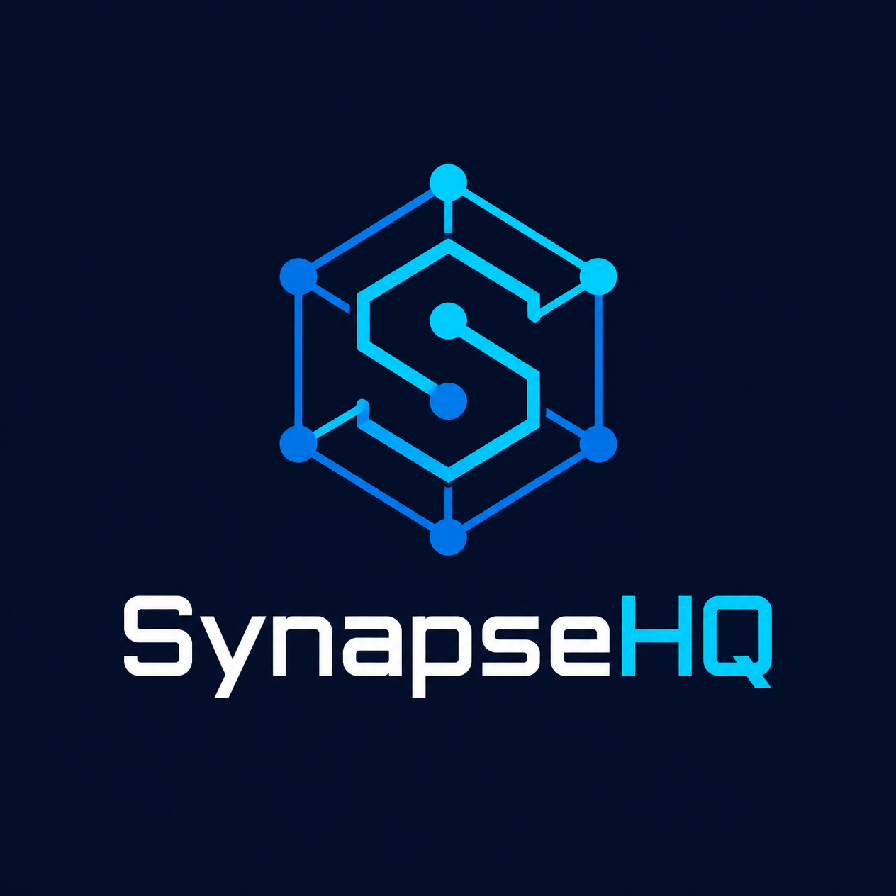

# SynapseHQ — Engineering Task & Velocity Workspace



**A modular project management workspace designed for software engineering teams.**

SynapseHQ is a full-stack workspace application concept focused on helping engineering teams organize projects, manage tasks, track milestones, and monitor team progress through a structured, data-dense interface.

The project is designed around a **Modular Monolith architecture**, with clearly defined domain boundaries, strict TypeScript practices, server-driven business logic, and custom authentication.

Its goal is to demonstrate practical full-stack engineering skills through a production-minded application rather than a basic CRUD tutorial.

> **Project status:** Authentication, workspace/project management, task collaboration, milestones, team allocation, and in-app notifications are implemented. Hardening and release verification are in progress; production deployment has not been verified.

---

## Table of Contents

- [Project Overview](#project-overview)
- [Core Features](#core-features)
- [Technology Stack](#technology-stack)
- [Architecture](#architecture)
- [Planned Project Structure](#planned-project-structure)
- [Authentication & Security](#authentication--security)
- [Database Design](#database-design)
- [Development Roadmap](#development-roadmap)
- [Getting Started](#getting-started)
- [Development Commands](#development-commands)
- [Environment Configuration](#environment-configuration)
- [Engineering Principles](#engineering-principles)
- [Remaining Work](#remaining-work)

---

## Project Overview

Engineering teams need more than a simple task list. They need a centralized workspace where projects, team responsibilities, development progress, and technical documentation can be managed together.

SynapseHQ aims to provide that environment.

The application is designed around four primary areas:

- **Workspace Management:** Organize engineering teams and their projects.
- **Project Management:** Track project progress, milestones, and team allocation.
- **Task Management:** Manage development tasks through Kanban boards and structured data tables.
- **Engineering Documentation:** Maintain project-related technical documentation using Markdown.

The application follows a server-first approach using Next.js App Router, Server Components, Server Actions, and a PostgreSQL database.

---

## Core Features

The repository currently implements the following product capabilities.

### 1. Custom Authentication

A custom authentication system built without relying on a heavy third-party authentication SDK.

Implemented capabilities:

- User registration and login.
- Secure bcrypt password hashing.
- JWT-based authentication with persistent session records.
- HTTP-only cookie-based sessions with immediate revocation.
- Logout and session lifecycle management.
- Protected application routes.
- Database-backed login throttling.
- Role-based, resource-level authorization for workspace, project, and task operations.

Technologies: `jose`, `bcryptjs`, and secure cookies.

### 2. Workspace & Project Management

Organize engineering work into dedicated workspaces and projects.

Implemented capabilities:

- Create and manage workspaces.
- Add and manage workspace members.
- Assign workspace roles.
- Create and update projects.
- Track project creators and manage project lifecycle.
- Control project access based on workspace membership.

Workspaces provide owner/admin/member roles. Projects inherit workspace access;
project creators can manage their own projects.

### 3. Hybrid Task Management

A task management experience designed for both visual workflows and structured data management.

Implemented capabilities include database-backed task creation, assignment to
workspace members, status and priority updates, due dates, filtering, sorting,
pagination, and access checks.

**Kanban Board**

- Organize tasks by status.
- Move tasks between workflow columns.
- Track task assignments and priorities.
- View task progress within a project.

**Data Table**

- Display tasks in a structured table.
- Filter and sort task records.
- Search by relevant task information.
- Manage task assignments and status transitions.

### 4. Task Details & Collaboration

Task detail pages support a focused workflow for coordinating implementation.

Implemented capabilities:

- Create one-level subtasks and associate tasks with project milestones.
- Add comments and review task activity history.
- Upload and download authorized task attachments (up to 3 MB; selected MIME
  types only), stored in PostgreSQL.
- Validate project/workspace access before task collaboration operations.

### 5. Milestone & Progress Tracking

Provide project-level visibility into engineering progress.

Implemented capabilities:

- Define project milestones.
- Associate tasks with project goals.
- Monitor milestone completion.
- Display project and milestone completion progress.

### 6. Team Allocation

Give project managers and team members visibility into responsibilities.

Workspace membership and task assignment are implemented, along with project
team allocation:

- Allocate workspace members to projects with an allocation percentage.
- View project team membership and allocation values.
- Enforce manager/creator permissions for allocation changes.

### 7. In-App Notifications

Notifications provide an in-product record of relevant task and project events.

Implemented capabilities:

- Notify users of task assignments, status changes, comments, milestone creation,
  and project team changes.
- View and mark notifications as read from the application header.
- Restrict notification access to the owning user.

Notifications are in-app only; email and push delivery are not implemented.

### 8. Engineering Documentation

Project-scoped Markdown documentation remains a planned capability.

---

## Technology Stack

The project uses the following installed stack.

| Layer             | Technology      | Purpose                        |
| ----------------- | --------------- | ------------------------------ |
| Framework         | Next.js 16+     | Full-stack React application   |
| UI Library        | React 19        | Component-based interface      |
| Language          | TypeScript      | Strict type safety             |
| Styling           | Tailwind CSS v4 | Utility-first styling          |
| Theme             | next-themes     | Class-based light/dark mode    |
| Database          | Neon PostgreSQL | Serverless relational database |
| ORM               | Drizzle ORM     | Type-safe database queries     |
| Validation        | Zod             | Input and schema validation    |
| Authentication    | jose            | JWT creation and verification  |
| Password Security | bcryptjs        | Password hashing               |
| Container         | Docker          | Production application image   |
| Database Hosting  | Neon            | PostgreSQL hosting             |

**Testing:** Vitest and Playwright are installed. Database integration tests run
when `TEST_DATABASE_URL` is configured; browser smoke tests use Playwright.
React Testing Library is installed, but component-level coverage is not yet a
maintained part of the test suite.

---

## Architecture

### Modular Monolith

SynapseHQ follows a Modular Monolith architecture.

The application runs as one deployable application while organizing business
logic into independent domain modules.

This approach provides:

- Clear separation of responsibilities.
- Explicit domain boundaries.
- Easier maintenance and testing.
- Reduced coupling between features.
- A practical foundation for future scaling.

The project does not require microservices or distributed infrastructure at its initial stage.

### Domain Modules

| Module        | Responsibility                                   |
| ------------- | ------------------------------------------------ |
| Auth          | Registration, login, sessions, and authorization |
| Workspaces    | Workspace creation and membership                |
| Projects      | Project lifecycle and ownership                  |
| Tasks         | Task creation, assignment, and workflow          |
| Notifications | In-app notifications and read state              |

Each module should own its domain-specific schemas, validation, services, and components where appropriate.

Shared infrastructure and genuinely reusable utilities belong in the shared layer.

### Request & Data Flow

The intended server-side request flow is:

```text
User Interaction
       |
       v
Server Action / Route Handler
       |
       v
Input Validation (Zod)
       |
       v
Authentication
       |
       v
Authorization
       |
       v
Domain Service
       |
       v
Repository (when useful)
       |
       v
Drizzle ORM
       |
       v
Neon PostgreSQL
```

Server Actions should remain thin entry points. Business rules belong in domain services, while database access should remain behind appropriate data-access boundaries.

---

## Planned Project Structure

The following is the target architectural layout, not the current repository tree. Directories and modules will be introduced incrementally as their implementation becomes necessary.

```text
SynapseHQ/
│
├── .agents/
│   ├── AGENTS.md
│   ├── ARCHITECTURE.md
│   └── roadmap.md
│
├── app/
│   ├── (auth)/
│   ├── (dashboard)/
│   ├── api/
│   ├── error.tsx
│   ├── globals.css
│   ├── layout.tsx
│   ├── loading.tsx
│   ├── not-found.tsx
│   └── page.tsx
│
├── src/
│   ├── modules/
│   │   ├── auth/
│   │   │   ├── actions/
│   │   │   ├── components/
│   │   │   ├── services/
│   │   │   ├── repositories/
│   │   │   ├── schemas/
│   │   │   ├── db/
│   │   │   └── index.ts
│   │   │
│   │   ├── workspaces/
│   │   ├── projects/
│   │   ├── tasks/
│   │   └── notifications/
│   │
│   └── shared/
│       ├── components/
│       │   └── layout/
│       ├── config/
│       ├── db/
│       ├── hooks/
│       ├── lib/
│       ├── types/
│       ├── utils/
│       └── errors/
│
├── drizzle/
│
├── docs/
│   └── architecture/
│       └── decisions/
│
├── public/
│
├── README.md
├── package.json
├── next.config.ts
├── tsconfig.json
├── drizzle.config.ts
├── vitest.config.mts
└── .env.sample
```

The Next.js App Router remains in the repository-root `app/` directory. The `src/` foundation was introduced in Phase 1; domain modules are added incrementally as their functionality is implemented.

---

## Authentication & Security

SynapseHQ implements custom authentication using:

- **bcryptjs:** Password hashing and verification at cost factor 12.
- **jose:** HS256 JWT signing and verification.
- **HTTP-only cookies:** Secure `synapse_session` token transport.
- **Persistent sessions:** Every JWT is backed by a revocable PostgreSQL session row.
- **Server-side authorization:** Authentication guards protect routes and sensitive actions.

Security measures include:

- Passwords are never stored in plaintext and are limited to 8–72 UTF-8 bytes.
- All authentication input is validated with Zod.
- Authentication secrets stay server-side.
- Cookies use HTTP-only, Secure in production, SameSite=Lax, and an explicit expiration.
- JWT signature, issuer, audience, expiration, claims, session state, and account status are verified.
- Logout revokes the persistent session immediately.
- Login throttling uses hashed email and IP identifiers in PostgreSQL.
- Server Actions rely on Next.js origin checks and SameSite cookies for CSRF mitigation.

`proxy.ts` performs optimistic navigation redirects only. The dashboard layout
and server-side session guards validate the JWT and persistent session against
the database. Proxy checks are never the only security boundary.

Resource-level workspace and project authorization is implemented in Phase 3.

---

## Database Design

Neon PostgreSQL will serve as the primary relational database, with Drizzle ORM providing type-safe database access.

### Planned Core Entities

| Entity            | Purpose                                 | Status      |
| ----------------- | --------------------------------------- | ----------- |
| Users             | User accounts and identity              | Implemented |
| Sessions          | Persistent authentication sessions      | Implemented |
| AuthLoginAttempts | Shared login throttling state           | Implemented |
| Workspaces        | Team workspaces                         | Implemented |
| WorkspaceMembers  | Workspace membership and roles          | Implemented |
| Projects          | Projects belonging to workspaces        | Implemented |
| Tasks             | Development tasks belonging to projects | Implemented |
| Notifications     | In-app user notifications               | Implemented |
| ProjectMembers    | Project team allocation                 | Implemented |
| Milestones        | Project milestones and task progress    | Implemented |
| TaskComments      | Task collaboration and discussion       | Implemented |
| TaskAttachments   | Authorized task file attachments        | Implemented |

### Relationships

- Sessions belong to users and cascade on user deletion.
- A user can have multiple active sessions.
- Login attempts are keyed by hashed email or IP identifiers.
- Users can belong to multiple workspaces.
- Workspaces contain projects, and projects contain tasks.

Schema changes are managed through version-controlled Drizzle migrations.

---

## Development Roadmap

Development will follow the phases defined in [`roadmap.md`](./.agents/roadmap.md).

| Phase   | Status      | Focus                     | Main Deliverables                                             |
| ------- | ----------- | ------------------------- | ------------------------------------------------------------- |
| Phase 1 | Complete    | Foundation & Architecture | Project structure, database foundation, development standards |
| Phase 2 | Implemented | Custom Authentication     | Registration, login, sessions, route protection               |
| Phase 3 | Implemented | Workspaces & Projects     | Workspace membership and project management                   |
| Phase 4 | Implemented | Task Management           | Kanban, table views, filtering, and sorting                   |
| Phase 5 | In progress | Polish & Deployment       | Hardening, verification, and production deployment            |
| Phase 6 | In progress | DevOps & Security         | Containerization, CI/CD, and security hardening               |

Each phase has its own implementation tasks and completion criteria.

A feature should only be marked complete after its implementation and relevant verification are finished.

---

## Getting Started

### Prerequisites

Before starting development, install:

- Node.js (compatible with the project's Next.js version).
- npm.
- Git.

A Neon PostgreSQL account is required for the database, and a Vercel account will be needed for deployment in Phase 5.

### 1. Clone the Repository

```bash
git clone https://github.com/programmer-bell/synapsehq.git
cd SynapseHQ
```

### 2. Install Dependencies

```bash
npm install
```

### 3. Configure Environment Variables

Copy the sample environment file:

```bash
cp .env.sample .env
```

On Windows Command Prompt:

```cmd
copy .env.sample .env
```

The sample configuration contains templates for:

```env
DATABASE_URL=
DATABASE_URL_UNPOOLED=
JWT_SECRET=
AUTH_SESSION_TTL_SECONDS=604800
NEXT_PUBLIC_APP_URL=http://localhost:3000
TEST_DATABASE_URL=
```

`DATABASE_URL`, `JWT_SECRET`, and `NEXT_PUBLIC_APP_URL` are required by the environment validator. `JWT_SECRET` must be at least 32 characters. `DATABASE_URL_UNPOOLED` is optional and is used by Drizzle Kit when available. `AUTH_SESSION_TTL_SECONDS` is optional and defaults to seven days (604800 seconds). `TEST_DATABASE_URL` is optional and should point to an isolated Neon branch or database for integration tests. The application validates runtime variables on the server and fails clearly when required configuration is missing.

### 4. Start the Development Server

```bash
npm run dev
```

Open:

```text
http://localhost:3000
```

---

## Development Commands

| Command               | Description                                             |
| --------------------- | ------------------------------------------------------- |
| `npm install`         | Install project dependencies                            |
| `npm run dev`         | Start the Next.js development server                    |
| `npm run lint`        | Run ESLint                                              |
| `npm run typecheck`   | Run TypeScript type checking                            |
| `npm test`            | Run unit tests and DB integration tests when configured |
| `npm run test:e2e`    | Run Playwright browser smoke tests                      |
| `npm run build`       | Create a production build                               |
| `npm run db:generate` | Generate Drizzle migrations                             |
| `npm run db:migrate`  | Apply Drizzle migrations                                |
| `npm run db:check`    | Check Drizzle migration consistency                     |
| `npm run db:studio`   | Open Drizzle Studio                                     |

Run linting, type checking, and tests after implementation changes. Run a production build when changes affect routing, configuration, or production rendering.

Vitest covers unit and integration tests, React Testing Library covers component tests, and Playwright covers end-to-end smoke tests. CI runs the full quality gate through `.github/workflows/ci.yaml`.

### Containerized Deployment

Build the production image:

```bash
docker build --target production -t synapsehq:local .
```

Run the application and a local PostgreSQL instance:

```bash
docker compose up --build
```

Set `POSTGRES_PASSWORD` and `JWT_SECRET` in `.env` before starting Compose. The
Compose database is bound to loopback only and communicates with the application
over the `synapsehq_net` network. Apply migrations against the Compose database
before using the application:

```bash
DATABASE_URL="postgresql://synapsehq:<password>@localhost:5432/synapsehq?sslmode=disable" npm run db:migrate
```

Production image publishing is restricted to `main` in CI. Configure the
`NEXT_PUBLIC_APP_URL` repository variable and, when automatic deployment is
enabled, the `ENABLE_PRODUCTION_DEPLOY` repository variable and
`VERCEL_DEPLOY_HOOK_URL` secret.

### Database Integration Tests and Authenticated E2E

Database integration tests and authenticated browser workflows are skipped
unless `TEST_DATABASE_URL` is set. Point it to an isolated Neon branch or
database, map both runtime and migration URLs to that test database, apply
migrations there, then run:

```bash
export TEST_DATABASE_URL="postgresql://..."
export DATABASE_URL="$TEST_DATABASE_URL"
export DATABASE_URL_UNPOOLED="$TEST_DATABASE_URL"
NODE_OPTIONS=--no-network-family-autoselection npm run db:migrate
npm test
npm run test:e2e
```

The test setup maps `TEST_DATABASE_URL` to `DATABASE_URL` for Vitest. Keep both
database variables pointed at the isolated test database when applying
migrations to avoid modifying development data. CI applies migrations and runs
database-backed checks only when the `TEST_DATABASE_URL` repository secret is
configured.

### Neon Connectivity Troubleshooting

If Node.js 24 times out while connecting to Neon in a restricted network
environment, run database commands with:

```bash
NODE_OPTIONS=--no-network-family-autoselection npm run db:migrate
```

This was required for the Phase 1 smoke verification.

---

## Engineering Principles

SynapseHQ is being developed with the following engineering principles:

**1. Modular by Design**

Keep domain responsibilities separate and avoid unnecessary coupling between modules.

**2. Strict Type Safety**

Use TypeScript strict mode and explicit types. Avoid unnecessary `any` usage and unsafe type assertions.

**3. Server-First Development**

Prefer React Server Components and server-side data access. Introduce Client Components when browser-side interaction requires them.

**4. Secure by Default**

Validate input, enforce authorization, protect authentication credentials, and keep secrets out of client-side code.

**5. Maintainable Database Design**

Use relational constraints, appropriate indexes, transactions, and controlled schema migrations.

**6. Incremental Implementation**

Build and verify one feature at a time. Avoid implementing future infrastructure before the application requires it.

**7. Testable Business Logic**

Keep business rules independent of UI components and introduce automated tests as the testing infrastructure is established.

---

## UI & Design Direction

The interface aims for a classic engineering-focused SaaS experience.

Design principles:

- Restrained zinc and slate monochrome palette.
- A maximum of one primary accent color.
- Crisp 1px borders and clear visual hierarchy.
- Compact, information-dense layouts.
- Tabular numerals for metrics and data tables.
- Tight typography and consistent spacing.
- Responsive dashboards, boards, and tables.
- Accessible controls and keyboard navigation.

The goal is to prioritize clarity, usability, and information density over unnecessary visual decoration.

---

## Remaining Work

These features are not implemented or have not yet been verified for production:

- Project-scoped Markdown documentation.
- Real-time task updates and external email/push notification delivery.
- Workspace invitations and advanced permission administration.
- Project analytics, velocity reporting, and sprint planning.
- Production deployment, live health checks, and release smoke tests.

---

## Project Documentation

The repository maintains separate documents for product development and engineering decisions:

| Document                                       | Purpose                                                             |
| ---------------------------------------------- | ------------------------------------------------------------------- |
| [`AGENTS.md`](./.agents/AGENTS.md)             | Repository-specific instructions and development rules              |
| [`roadmap.md`](./.agents/roadmap.md)           | Phased implementation roadmap and progress tracking                 |
| [`ARCHITECTURE.md`](./.agents/ARCHITECTURE.md) | Architectural boundaries, design decisions, and technical standards |
| [`README.md`](./README.md)                     | Project overview, setup, features, and documentation entry point    |

These documents should remain synchronized as the project evolves.

---

**SynapseHQ — Build better workflows. Track meaningful progress. Keep engineering teams aligned.**
